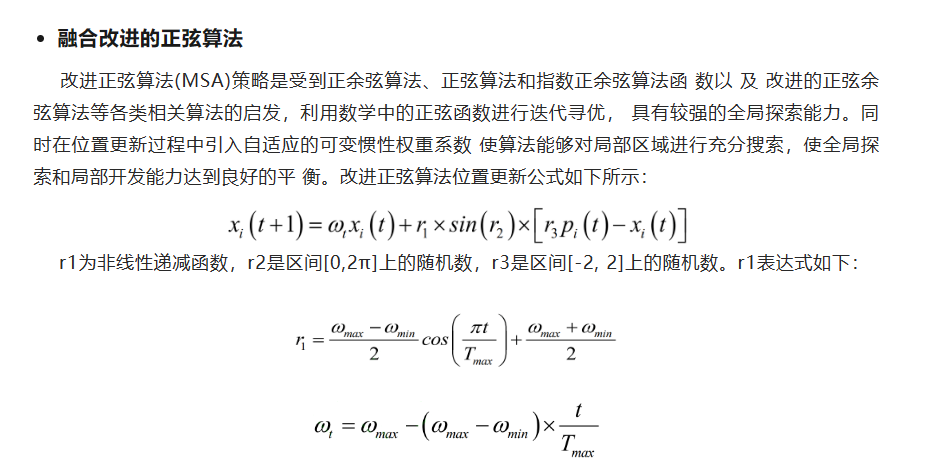
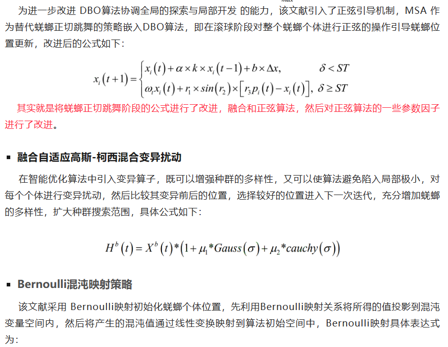
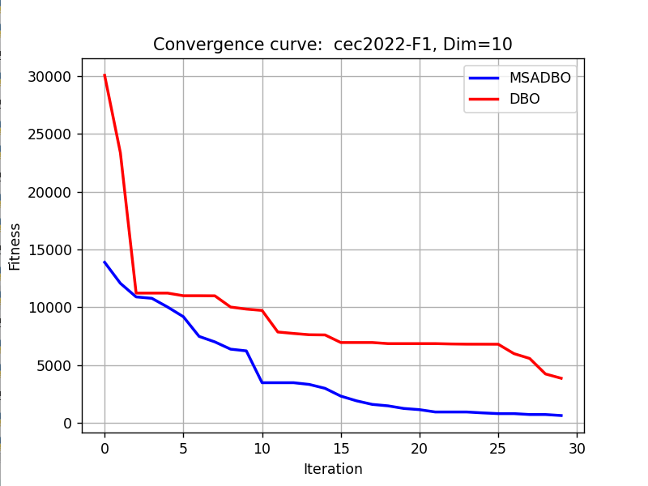
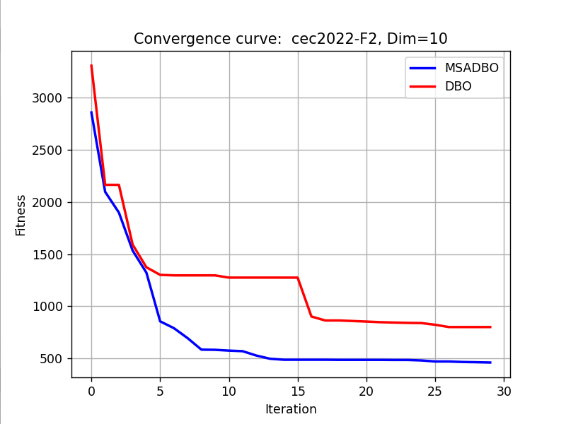

# Improved Dung Beetle Python Code (Sinusoidal Guidance + Mixed Gaussian-Cosine Variation + Chaotic Initialization)

The required packages are:
matplotlib~=3.8.2
numpy~=1.26.3
scipy~=1.12.0
opfunu~=1.0.1

The results are shown as follows:
Using the powerful opfunu library in Python, it integrates 11 CEC function libraries such as CEC2005/2008/2010/2013.

## Images

<!-- PAYMENT_BLOCK -->

## Get this dataset

- Payment link (Stripe): [Buy now](https://buy.stripe.com/3cs8yP7sY87d0vu9AB)
- Payment QR code: 

<!-- /PAYMENT_BLOCK -->
